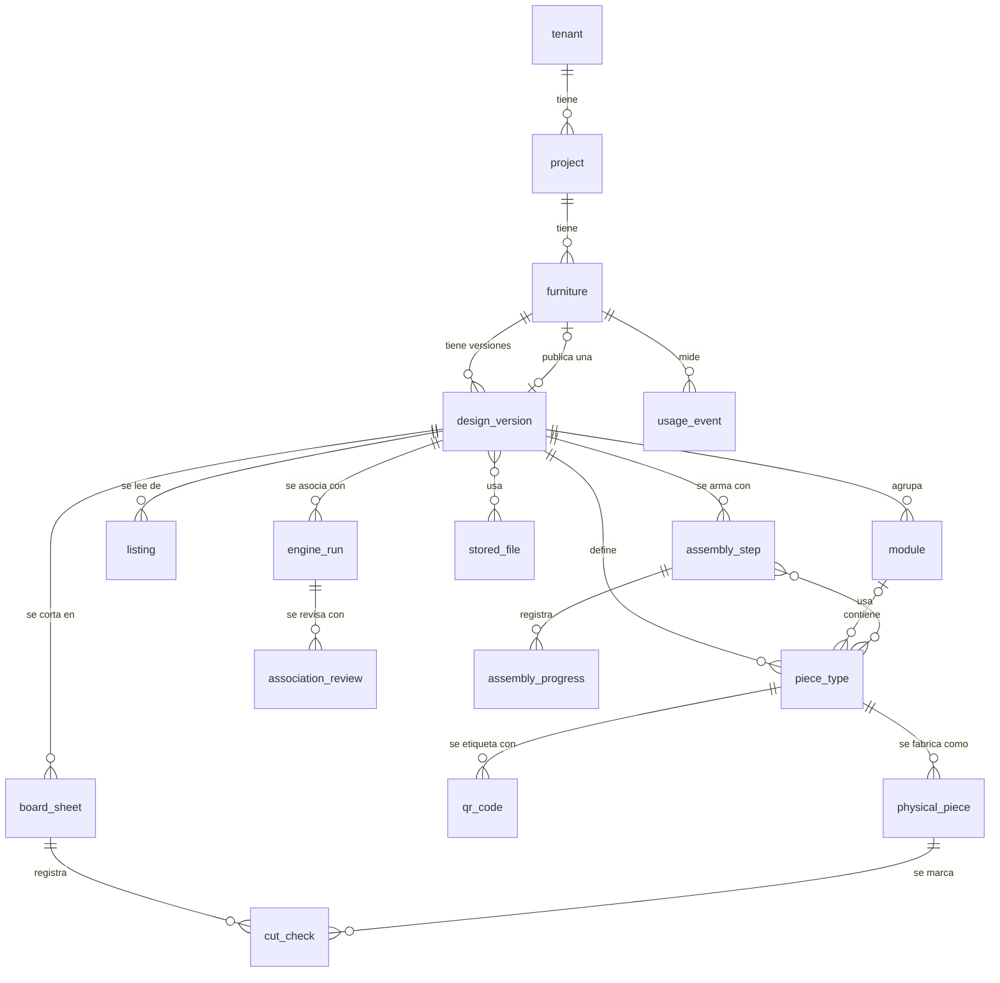

# Modelo de datos objetivo

Fecha: 17/11/2026 · Sesión 1 · Estado: **propuesta, a aprobar por el equipo**.
Antecedentes: ADR-002 (base y capa de acceso), ADR-003 (archivos), ADR-004 (sesión), ADR-005 (ERP), `src/data/types.ts` (tipos de la ficha), `src/engine/types.ts` (`AssociationRun`), `src/pdf/listing.ts` (`Listing`).

Es el modelo al que se llega al final de S6. Cada sesión crea solo las tablas que usa (columna «Sesión»). Los nombres de tabla son una propuesta; los tipos exactos se fijan en la spec de S2.

## 1. Reglas generales

1. **Toda tabla lleva `tenant_id`** (salvo `tenant`). Las claves foráneas son compuestas: `(tenant_id, id)`. Una fila no puede apuntar a otra de otra carpintería.
2. **Identificadores** generados en la aplicación (UUID como texto). Los del ERP se guardan como texto, tal cual llegan, y no se interpretan.
3. **Un código de pieza solo vale dentro de una versión de diseño.** Dos muebles pueden repetir códigos (pasa entre los dos fixtures).
4. **Lo publicado no se modifica.** Versiones de diseño, QR, corridas del motor y archivos son inmutables. Un cambio es una fila nueva.
5. **Lo que hace una persona o un operario se guarda como evento que se agrega**, no como un valor que se pisa: revisiones, checks, progreso. Deshacer es otro evento.
6. **La IA y el motor proponen; una persona decide.** Ninguna fila escrita por el motor cambia lo que ve el operario sin una publicación hecha por una persona.
7. Fechas en UTC. Medidas en milímetros.

## 2. Entidades

| # | Entidad | Tabla | Qué es | Campos principales | Sesión |
|---|---|---|---|---|---|
| 1 | Carpintería | `tenant` | Un tenant del ERP. | `id`, `erp_tenant_id` (opcional, único), `name`, `enabled` | S2 |
| 2 | Proyecto | `project` | Un trabajo para un cliente. | `id`, `erp_project_id` (opcional), `name` | S2 |
| 3 | Mueble | `furniture` | Un mueble de un proyecto. | `id`, `project_id`, `erp_furniture_id` (opcional), `name`, `published_version_id` (opcional) | S2 |
| 4 | Versión de diseño | `design_version` | Una carga completa de un mueble: su modelo, su listado y sus piezas. Inmutable desde que se publica. | `id`, `public_id` (opaco, para abrir la guía de armado), `furniture_id`, `number`, `status`, `model_id` (sha256 del .dae), `model_file_id` o `model_url`, medidas generales, tolerancia, datos del canto, `created_by`, `published_by`, fechas | S2 |
| 5 | Módulo | `module` | Agrupación de tipos de pieza dentro de una versión. **Propia del sistema y opcional.** | `id`, `design_version_id`, `name`, `position` | S2 |
| 6 | Tipo de pieza | `piece_type` | Una fila del listado: un código con sus medidas. | `id`, `design_version_id`, `module_id` (opcional), `code`, `name`, largo, ancho, espesor, `material`, `quantity`, `edge_banding`, `notes`. Único: (`design_version_id`, `code`) | S2 |
| 7 | Pieza física | `physical_piece` | Cada unidad de un tipo de pieza (un tipo con cantidad 2 tiene dos). | `id`, `piece_type_id`, `ordinal`, `instance_key` (opcional: la instancia del .dae que la representa) | S6 |
| 8 | QR | `qr_code` | Identificador opaco impreso en la etiqueta de un tipo de pieza. | `id` (aleatorio, 128 bits; es el texto del QR), `piece_type_id`, `design_version_id`, `created_at`, `revoked_at` (opcional). Nunca cambia de destino. | S2 |
| 9 | Archivo | `stored_file` | Metadatos de un archivo guardado (ADR-003). | `id`, `sha256`, `bytes`, `content_type`, `kind`, `original_name`, `storage_key`, `uploaded_by`, `created_at`. Único: (`tenant_id`, `sha256`) | S2 (tabla), S3 (uso) |
| 10 | Listado | `listing` | El listado de piezas leído de un PDF, un CSV o cargado a mano. | `id`, `design_version_id`, `source` (pdf, csv, manual), `source_file_id` (opcional), `status` (bloqueado, borrador, publicable), `listado_id` (sha256; solo si es publicable), `document` (el `Listing` completo, con excluidos y filas sin código) | S2 |
| 11 | Corrida del motor | `engine_run` | Un `AssociationRun` completo. | `id`, `design_version_id`, `engine_run_id` (sha256), `model_id`, `listado_id`, `passes`, `document` (el run), `created_at`. Único: (`design_version_id`, `engine_run_id`) | S2 |
| 12 | Revisión humana | `association_review` | La decisión de una persona sobre una instancia dudosa o sin asociar. | `id`, `engine_run_id`, `instance_key`, `decision` (confirmar, reasignar, descartar), `piece_type_id` (opcional), `reason`, `reviewer_user_id`, `created_at`. Solo se agrega; vale la última por instancia. | S6 |
| 13 | Tablero y check de cortes | `board_sheet`, `cut_check` | Una hoja de tablero del listado de cortes, y la marca de «pieza cortada». **Provisorio (R4).** | `board_sheet`: `design_version_id`, `material`, `sheet_index`, `sheet_count`. `cut_check`: `board_sheet_id`, `physical_piece_id`, `checked_at`, `undone_at`, autor | S6 |
| 14 | Paso de armado | `assembly_step`, `assembly_step_piece` | Un paso de la guía y los tipos de pieza que usa. | `assembly_step`: `design_version_id`, `module_id` (opcional), `position`, `title`, `text`, `image_file_id` (opcional). `assembly_step_piece`: `step_id`, `piece_type_id`, `quantity` | S6 |
| 15 | Progreso de armado | `assembly_progress` | Un paso marcado como hecho, o deshecho. | `id`, `assembly_step_id`, `kind` (hecho, deshecho), `occurred_at`, autor | S6 |
| 16 | Evento de uso | `usage_event` | Un hecho con hora, para medir tiempos. | `id`, `type`, `occurred_at` (hora del servidor), `client_at`, `furniture_id`, `design_version_id`, `piece_type_id` (opcional), `payload`, autor | S6 |
| 17 | Permiso por rol | `role_permission` | Qué permiso (leer, escribir) da cada rol del ERP en una carpintería. | `erp_role`, `permission` | S4 |

**Autor** (en 13, 15 y 16): `actor_kind` (usuario del ERP u operario sin usuario), `user_id` (opcional) y `device_id` (opcional; identificador aleatorio del celular). No hay tabla de usuarios: la identidad es la del ERP (ADR-004).

**Tipos de archivo** (`kind`): modelo .dae, zip del modelo, textura, imagen de paso, PDF de cortes, PDF de presupuesto, CSV de listado, SVG de placa.

**Estados de una versión de diseño:** borrador → en revisión → aprobada → publicada → reemplazada. También: rechazada. Son los estados del spike de CSV, más «reemplazada».

## 3. Relaciones

## 4. Decisiones del modelo

### 4.1 Por qué existe «versión de diseño»
El pedido habla de un QR «versionado e inmutable». Para eso hace falta algo que versionar: la versión de diseño. Reúne el .dae (`model_id`), el listado (`listado_id`) y las piezas de una carga. Los dos identificadores ya son sha256 del contenido, así que dos cargas iguales se reconocen solas.

### 4.2 QR versionado e inmutable
- Un QR apunta a **un tipo de pieza de una versión**. Nunca se le cambia el destino.
- Si se publica una versión nueva del mueble, la etiqueta vieja sigue abriendo su ficha, con el aviso «Hay una versión más nueva de este diseño» (el aviso ya existe en la ficha; hoy es un dato fijo y pasa a calcularse).
- Una versión nueva genera QR nuevos (ASUMIDO; consulta CA-12 sobre las etiquetas ya impresas).
- El texto del QR es `<base>/<ruta>/<id>`. La base y la ruta no se fijan hasta la consulta 59. El id no contiene ni el código ni la carpintería.
- Solo los tipos de pieza tienen QR (consulta 44). Los qrId del prototipo (`olmo-c04`, `olmo-mueble`, `olmo-mod-…`) se cargan como identificadores heredados del primer fixture para que la ficha actual no cambie; no se imprimen.

### 4.3 Tipo de pieza y pieza física
El QR identifica el **tipo** (consulta 44 y decisión del prototipo): dos piezas del mismo tipo son intercambiables. La pieza física existe para contar: el check de cortes es «un check por pieza física por tablero» (R4, provisorio). `instance_key` enlaza una pieza física con una instancia del 3D cuando haga falta resaltarla; no es obligatorio.

### 4.4 Dónde vive la asociación
La corrida del motor guarda el resultado completo como documento. La asociación vigente de una instancia es: la última revisión humana si existe; si no, el resultado del motor **solo si es `segura`**. Una versión no se publica mientras queden instancias dudosas o sin asociar sin revisión (regla del spike de CSV, que pasa al producto).

### 4.5 Eventos de uso
Sirven para medir el efecto del sistema (objetivo del PFG: tiempo y errores de clasificación y armado). Tipos iniciales: QR escaneado, ficha abierta, paso de armado iniciado, paso completado, corte marcado. Se guarda la hora del servidor y la del celular. No se guardan datos personales del operario: solo el identificador aleatorio del dispositivo y, si lo escribió, un nombre. Qué tiempos interesa medir es la consulta CA-16.

## 5. Mapeo con el ERP

El ERP tiene Proyecto → Mueble → Piezas, sin módulos.

| ERP | Este sistema | Cómo se enlaza |
|---|---|---|
| Tenant | `tenant` | `erp_tenant_id` |
| Proyecto | `project` | `erp_project_id` (opcional: un proyecto cargado a mano no lo tiene) |
| Mueble | `furniture` | `erp_furniture_id` (opcional). Uno a uno (ASUMIDO, consulta CA-8) |
| — | `design_version` | No existe en el ERP. Varias por mueble. |
| — | `module` | No existe en el ERP. Opcional. |
| Piezas (objetos de primer nivel del .dae) | **No se enlazan** | La lista del ERP pierde componentes dentro de grupos y recorta códigos. El sistema lee el .dae original. |
| Documento «modelo 3D» (zip) | `stored_file` (zip, .dae, texturas) | Se descarga por `ErpClient` y se guarda con su sha256 |
| Documento «optimización de cortes» (PDF) | `stored_file` y `listing` | Entrada del listado (cuando la lectura del PDF esté habilitada) |
| Documento «presupuesto» (PDF) | No se usa | Fuera de alcance |
| Usuario | No hay tabla | `user_id` como texto en revisiones y eventos |

**Sin módulos en el ERP:** el módulo se define en este sistema, al cargar o revisar el diseño. Un mueble sin módulos es válido: sus tipos de pieza tienen `module_id` vacío. La ficha actual exige un módulo por pieza (`PieceType.moduleId`); mientras la ficha no cambie, la lectura hacia la ficha usa un módulo único con el nombre del mueble cuando no hay ninguno (ASUMIDO; es una regla del adaptador de lectura, no un dato guardado). El segmento `M01` del código no se usa para agrupar (consulta 42).

## 6. Abierto

| # | Tema | Depende de |
|---|---|---|
| MD-1 | Formato del check de cortes y si hay un orden de cortes | Consultas 35 a 37 |
| MD-2 | Si un mueble se fabrica más de una vez (haría falta la entidad «unidad» entre mueble y progreso) | CA-13 |
| MD-3 | De dónde salen los pasos de armado | CA-9 |
| MD-4 | Reutilizar un QR cuando una pieza no cambia entre versiones | CA-12 |
| MD-5 | Fondos de 3 mm: canteado `[]` o sin definir (PDF-2). No cambia el modelo: `edge_banding` admite lista, vacío y «sin definir» | Ya abierto en `CLAUDE.md` |
